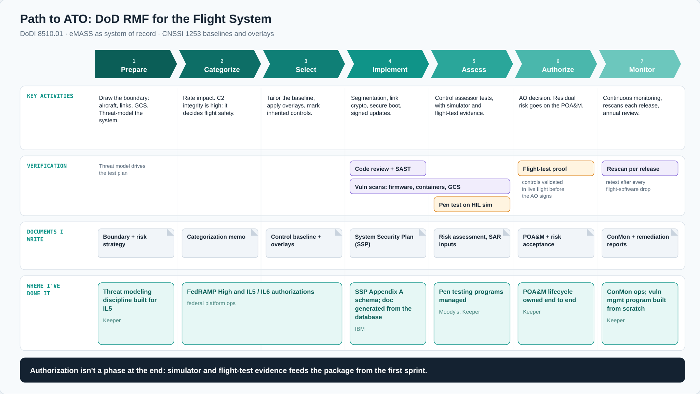
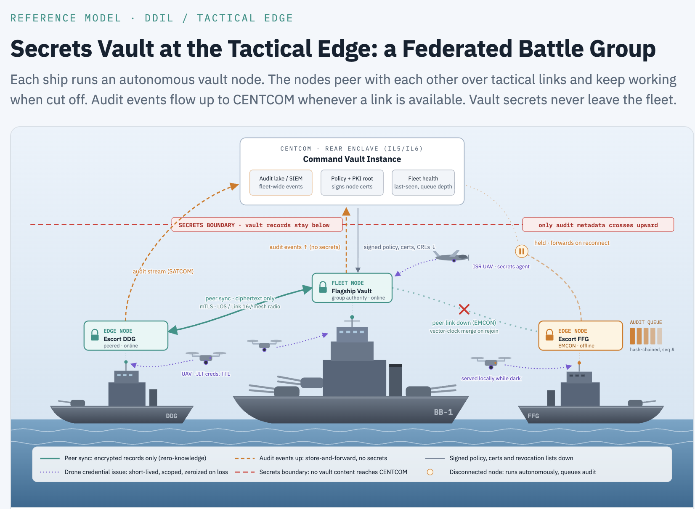
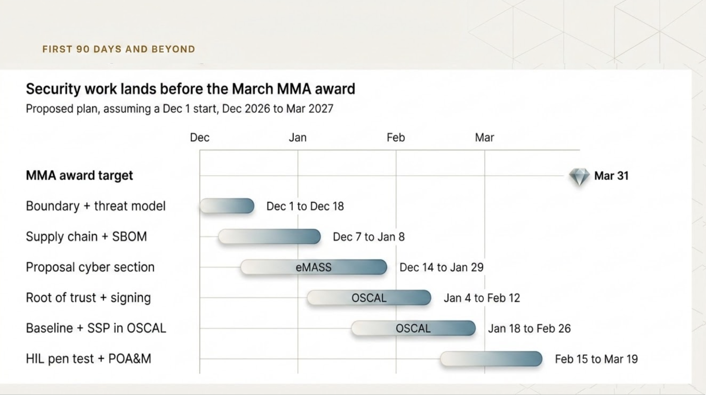
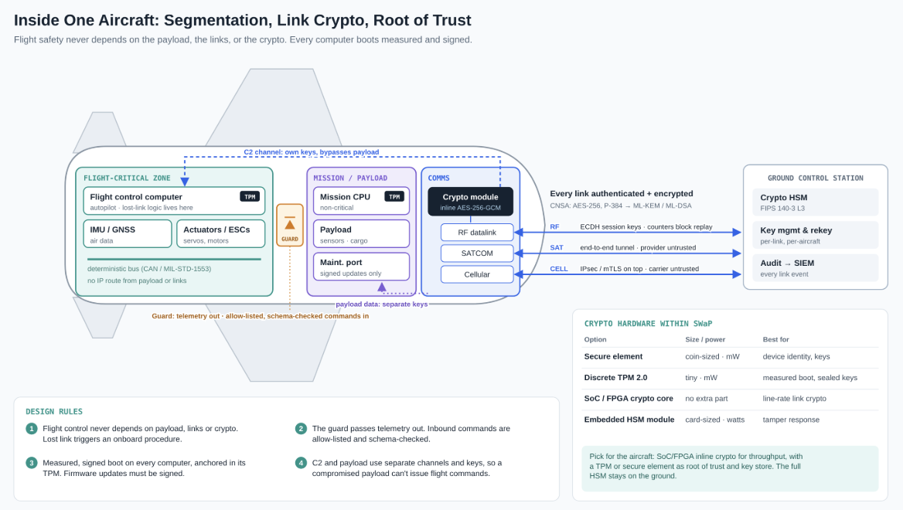
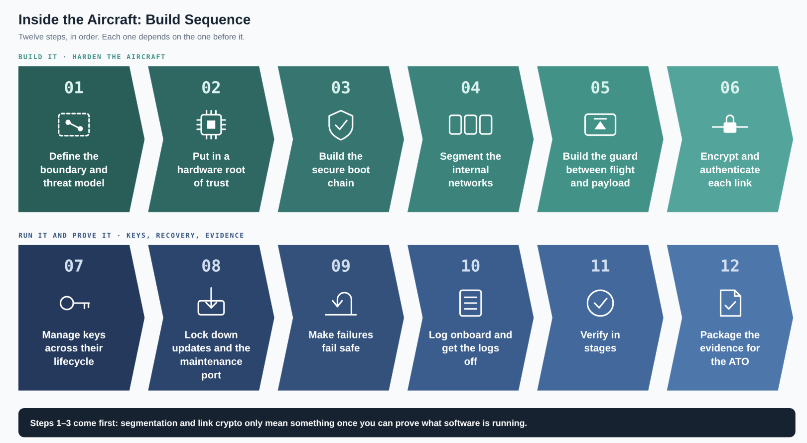

# Taking a FedRAMP High Platform to Department of Defense (DoD) Impact Level 5 (IL5)

**Cyber Security Engineer · Project Presentation**
Federal Platform Operations · 2026 · Kim Zvik

---

## 2. The Starting Point

### Authorization-grade security, with no program in place

| A federal bar | Many sources | Contractual clocks |
| --- | --- | --- |
| A FedRAMP High platform pursuing DoD Impact Level 5 (IL5), with air-gapped deployments in scope. | Findings from BugCrowd researchers, enterprise customers in financial services, and internal testing. | Customer contracts set response commitments, so every finding carried a deadline. |

---

## 3. Path to ATO: DoD RMF for the Flight System

*Authorization isn't a phase at the end: simulator and flight-test evidence feeds the package from the first sprint.*

---

## 4. The Project, End to End

### From no sponsor to an audited IL5 system

| Step | Stage | What happened |
| --- | --- | --- |
| 01 · Sponsorship | Find a sponsor | We had none. Found one and selected the Millennium Challenge Corporation. |
| 02 · Path | Choose the IL5 route | Knox Systems, UberEther, or going direct, the long way. We chose UberEther. |
| 03 · Requirements | Define the target | Functional and technical requirements for running inside the UberEther enclave. |
| 04 · Build | Build in the enclave | Built the system out on their enclave. Most of it was a lift and shift. |
| 05 · Validate | Test, pilot, user testing | Testing, pilot and user acceptance inside the enclave. |
| 06 · Audit | Audit | Audited the system as built on the UberEther enclave. |

---

## 5. Challenges in the Enclave

### Where the build met DoD reality

| Area | What happened | What it taught |
| --- | --- | --- |
| Image scanning | Our images had to pass their scanners without being rejected. | Get the scanning criteria before the first build. Have the same tooling on the commercial side. |
| DoD banner, FIPS 140-3 | Build rejected for missing the DoD system-use splash screen; upgraded Federal Information Processing Standards (FIPS) 140-2; added after. | Better requirements gathering avoids late rejections. |
| One code base | Feature flags existed only at the database level. | Added flags at the code level to keep one code base safely. Avoid lowest-common-denominator cipher suites. |
| Observability | Their stack is OpenSearch; monitoring and alerting rebuilt separately. | A normalizing proxy makes multiple stacks simple. |
| Toolchain | They use GitLab; we use GitHub. | Easy to bridge. |
| Images, not containers | Elastic Beanstalk instead of EKS, so build and release were slower. | Plan release cadence around the platform. |

---

## 6. What I Built

### One lifecycle, from first report to closed POA&M item

| Stage | Description |
| --- | --- |
| **Intake** | One queue for researcher, customer and internal findings. |
| **Triage** | Written criteria: in scope, reproducible, duplicate, exploitable. |
| **Severity** | One consistent severity assessment applied to every finding. |
| **Remediation SLOs** | Fix targets by severity, tied to contractual commitments. |
| **Escalation** | A defined path when an SLO is at risk of being missed. |
| **POA&M lifecycle** | Open weaknesses tracked with milestones through closure. |

---

## 7. Beyond the Queue

### Threat modeling and testing as engineering habits

- **Threat modeling:** Built the threat modeling discipline inside engineering teams to support IL5.
- **Penetration testing:** Managed pen testing, as I had earlier at Moody's.
- **Customer risk conversations:** Tier 3 calls with banks on Common Vulnerabilities and Exposures (CVEs) and high product privileges.
- **Air-gapped scope:** Took on air-gapped deployments and customer-facing work in 2026.

---

## 8. Reference Model: Secrets Vault at the Tactical Edge

Each ship runs an autonomous vault node. The nodes peer with each other over tactical links and keep working when cut off. Audit events flow up to CENTCOM whenever a link is available. Vault secrets never leave the fleet.

---

## 9. July 2026 · Pre-DEF CON Report Surge

# +30%

**SLO performance, with AI-assisted triage and no added headcount**

Report volume spiked before DEF CON, compounded by AI-discovered and AI-generated submissions. AI agents triaged reports and opened pull requests for fixes.

---

## 10. What I Got Wrong

### Automation that helped my team and swamped everyone else

| What happened | What I did | What changed |
| --- | --- | --- |
| Agents posted full analysis to Jira. Engineering leaders followed the BugCrowd Slack feed, which became too noisy to use. | Took their side of it instead of dismissing the pushback. Analysis moved to a wiki page; Jira got only the link. | An AI policy to cut noise, and an agent that writes an executive summary plus tiered detail by audience. |

---

## 11. Applying It to Autonomous Aircraft

### Same discipline, new system boundary

| Prior work | Applied to an autonomous aircraft program |
| --- | --- |
| Vulnerability intake and POA&M lifecycle | One POA&M, kept current in eMASS from IATT through ATO |
| Threat modeling to support IL5 | Threat models for RF, satellite and cellular C2 links, and for flight/payload isolation |
| IL5 enclave: DoD banner, code-level flags | Requirements captured up front; one code base across test and operational aircraft |
| Air-gapped deployment work | Controlled update paths: over the air via C2, or the aircraft's network port |
| AI-assisted triage | Evidence generated from the pipeline, ready for continuous ATO |

---

## 12. First 90 Days and Beyond

---

## 13. Inside One Aircraft: Segmentation, Link Crypto, Root of Trust

*Flight safety never depends on the payload, the links, or the crypto. Every computer boots measured and signed.*

---

## 14. Discussion

### Questions for the team

- Who is your Authorizing Official, and which program office sponsors you?
- Are you flying under an IATT today, or still before that stage?
- Is the aircraft being treated as Platform IT?
- Who owns airworthiness certification, and how closely does it work with cyber?

Kim Zvik · kimzvik@gmail.com · linkedin.com/in/kimzvik

---

## 15. Inside the Aircraft: Build Sequence

*Steps 1–3 come first: segmentation and link crypto only mean something once you can prove what software is running.*

---

## 16. Start Up Born and Raised

| Company | Employees | Investment status |
| --- | --- | --- |
| Kindle (Home Accounting) | 5 | Private |
| Avantos | 14 | Series A |
| Bear River and Associates | 30 | Private |
| Vivsoft (FDIC Contractor) | 30 | Private |
| Moody's Analytics (subsidiary of Moody's) | 300 | Public |
| Keeper Security | 300 | Series D |
| MSCI Barra (acquired by MSCI) | 378 | Acquired |

---

## 17. Terminology

| Term | Meaning |
| --- | --- |
| 20X | Cloud-native ATO without a sponsoring agency |
| AES-256 | Advanced Encryption Standard, 256-bit |
| AI | Artificial Intelligence |
| ATO | Authority to Operate |
| BOD 4-2026 | Binding Operational Directive |
| C2 | Command and Control |
| CAN | Controller Area Network |
| CENTCOM | Central Command |
| CNSA | Commercial National Security Algorithm |
| CNSSI | Committee on National Security Systems Instruction |
| CPU | Central Processing Unit |
| CVE | Common Vulnerabilities and Exposures |
| DDG | Guided missile destroyer |
| DDIL | Denied, Disrupted, Intermittent, and Limited |
| DEF CON | Annual hacker and security conference |
| ECDH | Elliptic-Curve Diffie–Hellman |
| eMASS | Enterprise Mission Assurance Support Service |
| EMCON | Emissions Control |
| ESC | Electronic Speed Controller |
| FFG | Guided missile frigate |
| FIPS 140-3 | Federal Information Processing Standard for cryptographic modules |
| FPGA | Field Programmable Gate Array |
| GNSS | Global Navigation Satellite System |
| HSM | Hardware Security Module |
| IL5 | Impact Level 5 |
| IMU | Inertial Measurement Unit |
| IP | Internet Protocol |
| MIL-HDBK-516C | Department of Defense Handbook: Airworthiness Certification Criteria |
| MIL-STD-1553 | Military standard for an avionics serial data bus |
| ML-DSA | Module-Lattice-Based Digital Signature Algorithm |
| ML-KEM | Module-Lattice-Based Key-Encapsulation Mechanism |
| MMA | Massed Modular Aircraft |
| mTLS | Mutual Transport Layer Security |
| NIST 800-53 | National Institute of Standards and Technology security and privacy controls |
| OSCAL | Open Security Controls Assessment Language |
| OT | Operational Technology |
| P-384 | NIST elliptic curve used for public-key cryptography |
| POA&M | Plan of Action and Milestones |
| Purdue Levels | Purdue Enterprise Reference Architecture |
| RF | Radio Frequency |
| RMF | Risk Management Framework |
| SAR | Security Assessment Report |
| SATCOM | Satellite Communications |
| SBOM | Software Bill of Materials |
| SLA | Service Level Agreement |
| SLO | Service Level Objective |
| SoC | System on Chip |
| TPM | Trusted Platform Module |
